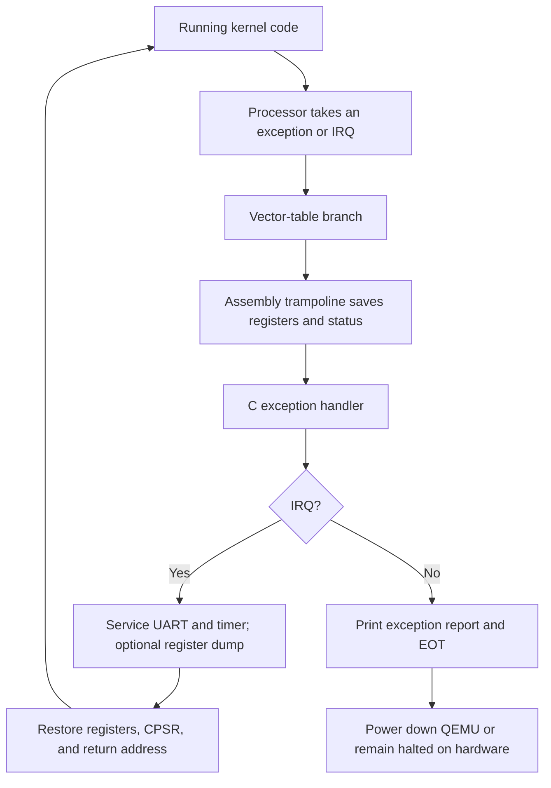

# Architecture

The kernel runs on core 0 of a Raspberry Pi 2 B / BCM2836 platform and uses
ARM state. The course's patched QEMU is the reference used for local execution.
Device registers are accessed through volatile pointers; the program is
freestanding and uses its own UART output and formatting code.

## Startup

`arch/cpu/entry.S` starts at `_start`, leaves Hypervisor mode when necessary,
parks the other cores, and enables alignment checking. It initializes five mode
stacks reserved by `kernel.lds`; each stack has 16 KiB and an eight-byte-aligned
top. User and System modes share a register bank and stack.

The entry code installs `exception_vectors` in VBAR and retains the course's
`test_kernel_set_config` call immediately before `start_kernel`. Configuration
values can therefore be supplied by the test framework before device setup.

`kernel/start.c` initializes the interrupt controller, UART, and system timer,
prints the startup marker, enables IRQs, calls `test_kernel`, and enters the
required keyboard-command loop.

## Exceptions and interrupts

`arch/cpu/trampolines.S` saves r0-r12 and an adjusted return address. CPSR and
SPSR complete a 64-byte frame, keeping the exception stack aligned for the C
call. The handler receives a pointer to that frame and an exception identifier.
On an IRQ return, the saved SPSR, general registers, stack position, and program
counter are restored; the exception-return instruction restores CPSR.

`arch/cpu/exceptions.c` dispatches shared IRQs by checking both UART and timer
pending bits. IRQ reports depend on the externally visible `irq_debug` flag,
which starts false. Other exception types print the fault location, relevant
fault registers, and the register snapshot, then send EOT. QEMU builds call the
supplied `powerdown()` helper; hardware builds remain in the handler's wait loop.

The banked-register snapshot uses ordinary register reads for the current
exception mode and banked reads for the other modes, avoiding an invalid banked
access to the current mode.

## UART and buffering

The PL011 is mapped at physical address `0x3f201000`. Transmission remains
polled: `uart_putc` waits for space before writing the data register. `kprintf`
streams formatted output through these UART operations without dynamic allocation.

Reception is interrupt driven. The UART handler acknowledges receive interrupts,
drains available bytes into the supplied 128-byte ring buffer, and returns.
`uart_getc` reads from that buffer and waits when it is empty. A full buffer
discards newly received bytes while still draining the UART. Input already
queued in the buffer keeps its order.

## Timer

The BCM system timer uses compare channel 1. It schedules the first deadline
from the current counter plus `TIMER_INTERVAL`, acknowledges each match, and
advances the next deadline until it is in the future. Each serviced timer
interrupt prints `!` followed by a newline.

The repeated-character routine deliberately stays busy between characters.
Timer output interleaves with its output, while UART interrupts continue to
collect input. This demonstrates that IRQ handling preserves the interrupted
program's state.

## Reference manuals

- [BCM2835 peripherals](https://datasheets.raspberrypi.com/bcm2835/bcm2835-peripherals.pdf)
- [BCM2836 core control](https://datasheets.raspberrypi.com/bcm2836/bcm2836-peripherals.pdf)
- [ARMv7 architecture reference](https://developer.arm.com/documentation/ddi0406/latest)
- [PL011 technical reference](https://developer.arm.com/documentation/ddi0183/g)
- [AAPCS32 calling convention](https://github.com/ARM-software/abi-aa/blob/main/aapcs32/aapcs32.rst)
